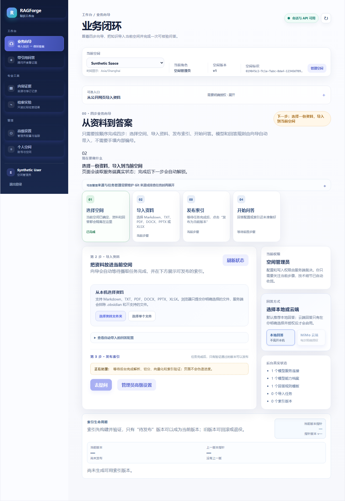
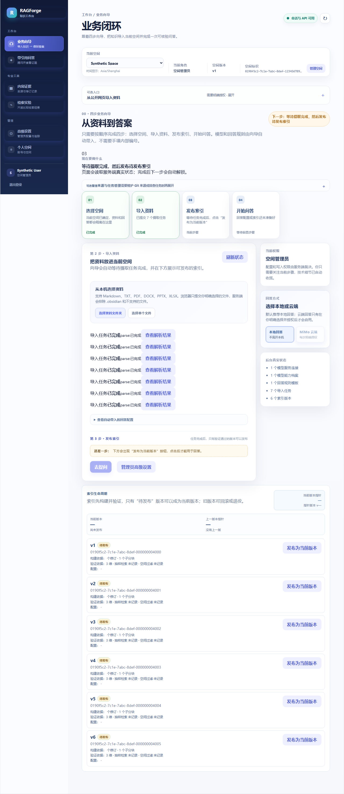
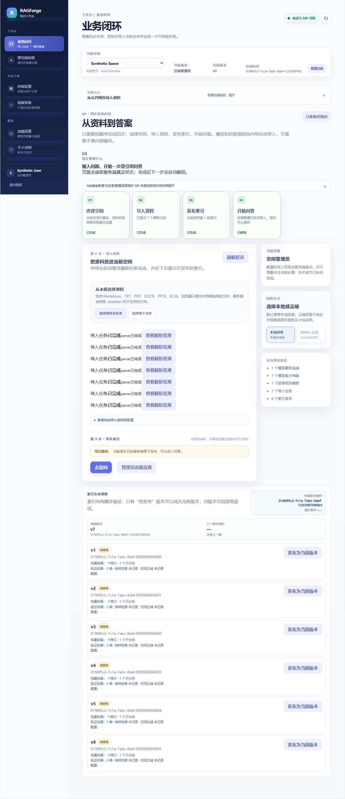
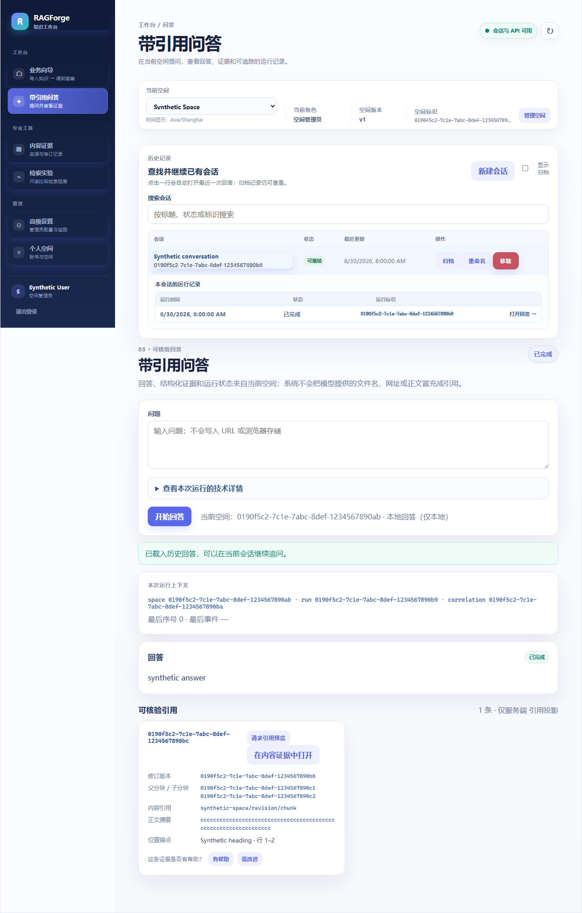

# RAGForge 一整套业务操作演示

版本：P7C-14 / v1
适用入口：前端“业务向导”
演示边界：截图来自浏览器端到端合成数据验收，不读取真实个人资料，不写入真实模型密钥，也不打开云端出境。

## 先看懂页面

普通使用者只需要关注四个步骤：

1. 选择空间：确认资料和回答都落在正确的知识空间。
2. 导入资料：选择本机文件或文件夹，提交后等待服务端处理。
3. 发布索引：只有服务端验证通过的版本才能发布为当前版本。
4. 开始问答：提问后查看回答、引用证据和运行状态。

来源库、任务中心、模型服务、模型能力、回答规则和运行追踪已经收拢到“高级设置”或“来源与任务管理”中。它们是维护和排错工具，不是普通用户的必经配置。

页面上的标识、版本号、哈希和模型名属于可审计技术详情，默认折叠或放在小字区域；它们不会要求普通用户手填。模型、回答规则和云端出境仍由服务端权限与空间边界最终裁决。

## 操作闭环

### 1. 登录并选择知识空间

登录后，顶部“当前空间”决定后续所有资料、索引、问答和历史记录的 `space_id` 边界。没有空间时，先在“个人空间”创建一个空间，再回到“业务向导”。

### 2. 导入资料并查看真实进度

在“第 2 步 · 导入资料”选择资料文件夹或单个文件，点击“开始导入”。页面显示服务端返回的任务状态、解析结果和逐项步骤；不会用前端假进度替代后台状态。

### 3. 发布已验证索引

任务完成后，在同一页查看索引生命周期。只有“待发布”的候选版本可以点击“发布为当前版本”；发布后页面显示当前版本指针。失败或不属于当前空间的版本不能被绕过。

### 4. 完成一次带引用问答

点击“去提问”进入“带引用问答”，输入问题并提交。回答正文、引用证据、当前运行上下文、事件和用量均来自结构化服务端投影。引用只展示允许列表中的证据，不把模型自由文本当作引用。

### 5. 查找和恢复历史数据

历史会话现在集中在表格中，列出会话、状态、最近更新时间和操作。点击会话行会自动打开最近一次回答；展开后可选择具体运行记录。归档会话仍可通过“显示归档”查看，但只能读，不能继续提问；要继续操作请点击“新建会话”。

## 配置中心怎么用

普通使用者无需进入配置中心。管理员第一次使用一个空间时，按以下顺序完成一次性配置：

1. 在“模型服务连接”登记或验证连接；凭据只使用服务端引用，不在页面展示密钥。
2. 创建并发布“模型能力档案”，确认用途、模型和能力与实测结果一致。
3. 创建并发布“模型路线”，明确本地或云端出境等级；不会静默切换到另一条云端路线。
4. 创建并发布“回答规则模板”，问答入口只使用已发布版本。
5. 回到业务向导，普通用户只需导入资料和提问。

云端 MiMo 只在用户明确选择且空间授权有效时使用；本地回答保持仅本地边界。配置页面中的内部标识、版本和哈希只用于排错和审计，放在高级设置或技术详情中。

## 验收结果

- 前端生产构建：`npm run build --prefix frontend/ragforge-web`
- 类型检查：`npm run format:check --prefix frontend/ragforge-web`
- 单元测试：`npm run test:unit --prefix frontend/ragforge-web`
- 浏览器端到端测试：`npm run test:e2e --prefix frontend/ragforge-web`
- 历史恢复用例：`[J9 历史恢复]`，覆盖表格展示、初始运行恢复、点击会话加载最近回答和运行记录。
- 数据边界：演示使用合成空间、合成文档和合成回答；跨空间访问、只读角色和归档读取均保留拒绝/只读验证。

原始测试证据见 [`tests/evidence/P7C-14-ux-demo.v1.json`](../tests/evidence/P7C-14-ux-demo.v1.json)。
